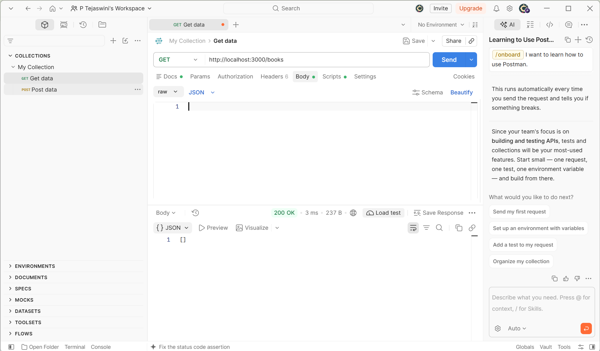
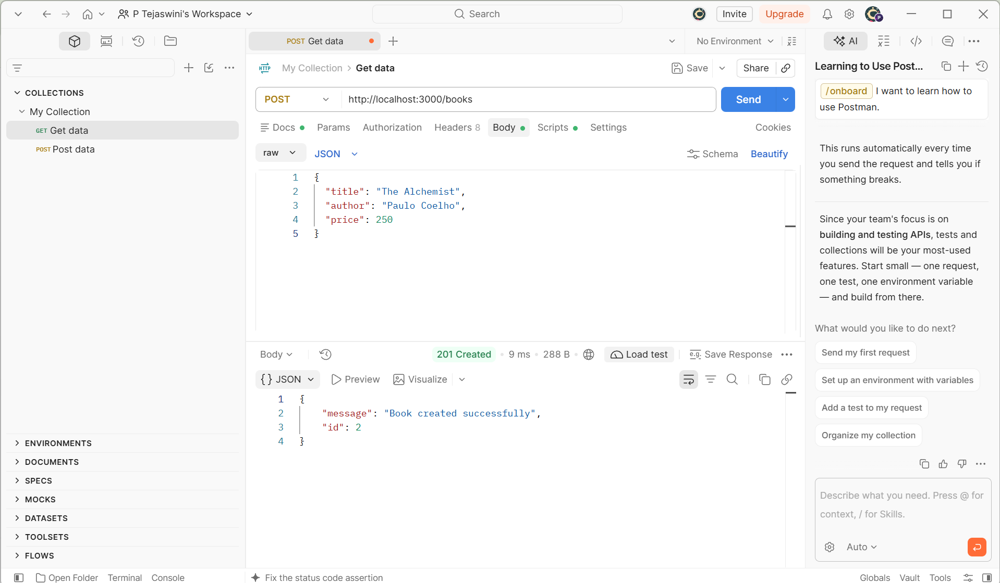
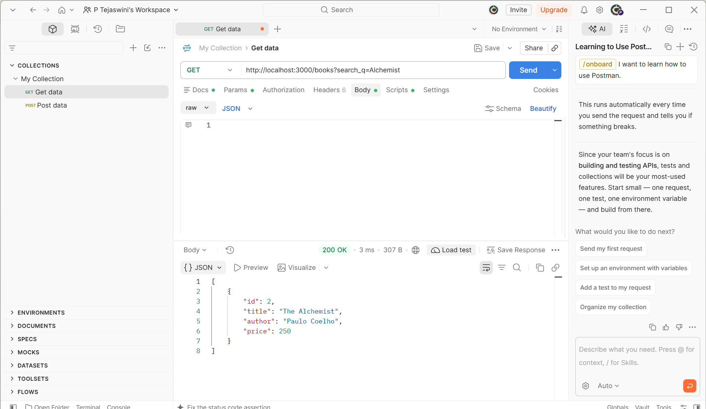
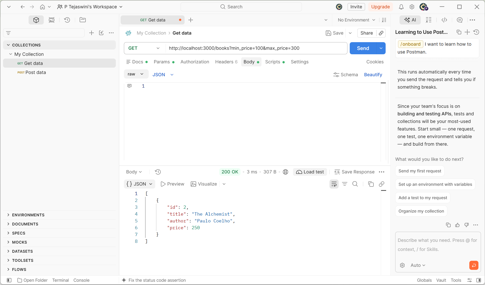
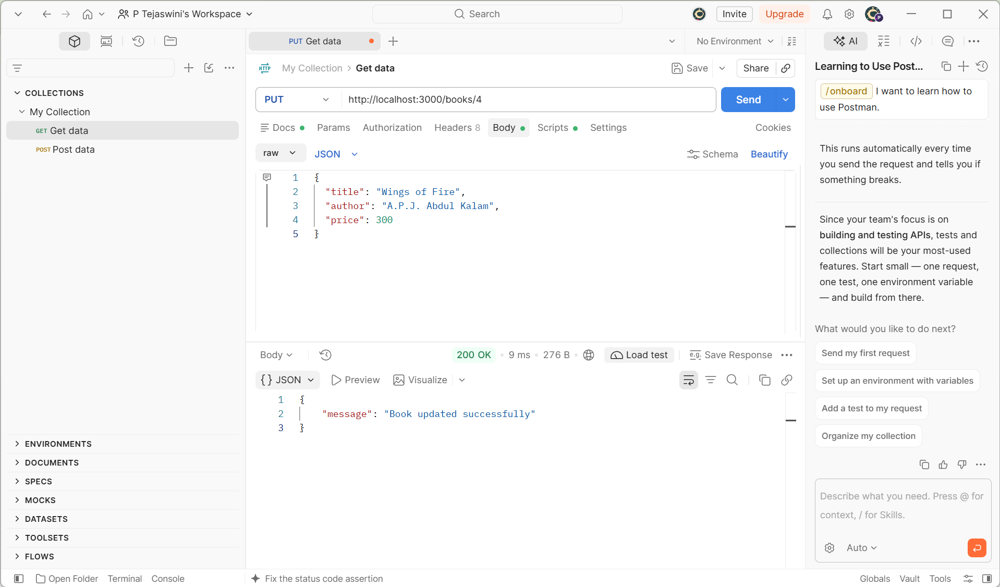
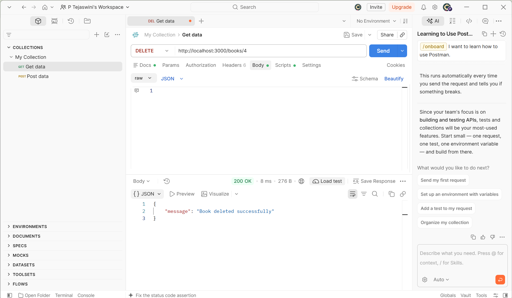
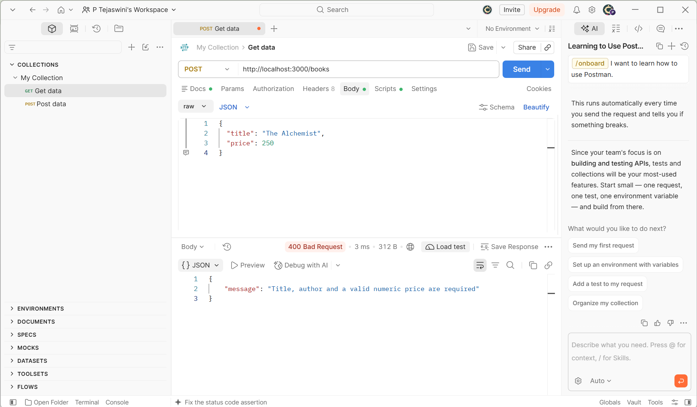
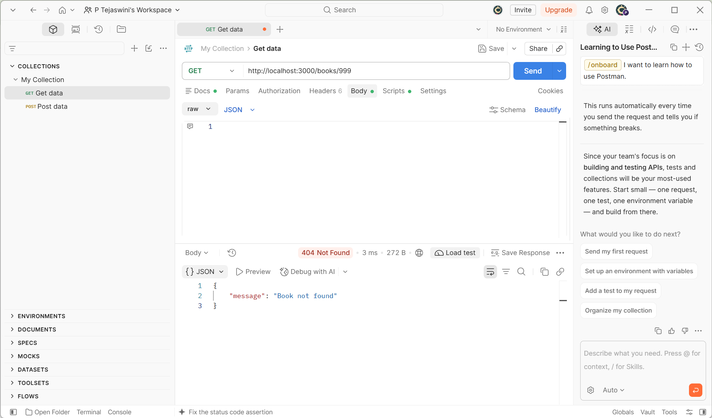

# Lab 3: REST API, Query Parameters, Validation and Debugging

## Student Details

- **Name:** Tejaswini
- **Registration Number:** [Enter your registration number]
- **Section:** [Enter your section]
- **Course:** Backend Development Fundamentals

## 1. Introduction

This lab focuses on developing a REST API using Node.js, Express.js and SQLite. The API performs CRUD operations on books and supports searching, sorting, pagination, price filtering and input validation.

## 2. Technologies Used

- Node.js
- Express.js
- SQLite
- Postman
- JavaScript

## 3. Installation and Execution

### Install dependencies

```bash
npm install
```

### Start the server

```bash
node app.js
```

The server runs at:

```text
http://localhost:3000
```

The SQLite database and books table are created automatically when the application starts.

### Environment Variables

No environment variables are required for this lab.

## 4. API Endpoints

| Method | Endpoint | Description |
|---|---|---|
| GET | `/books` | Retrieve all books |
| GET | `/books/:id` | Retrieve a book by ID |
| POST | `/books` | Add a new book |
| PUT | `/books/:id` | Update an existing book |
| DELETE | `/books/:id` | Delete a book |

### Query Parameters

- `search_q`: Search books by partial title.
- `order_by`: Select the column for sorting.
- `order`: Sort in ASC or DESC order.
- `limit`: Set the maximum number of records.
- `offset`: Set the starting record.
- `min_price`: Set the minimum price.
- `max_price`: Set the maximum price.

## 5. Screenshots and Testing

### 1. GET All Books


### 2. POST - Create a Book


### 3. Search Books


### 4. Sorting Books


### 5. Price Filtering


### 6. PUT - Update a Book


### 7. DELETE - Delete a Book


### 8. Input Validation


### 9. Book Not Found


## 6. HTTP Status Codes

- **200 OK:** Request completed successfully.
- **201 Created:** Book created successfully.
- **400 Bad Request:** Invalid or missing input.
- **404 Not Found:** Requested book does not exist.
- **500 Internal Server Error:** Server-side error.

## 7. Conclusion

Successfully developed and tested a REST API using Node.js, Express.js and SQLite. Implemented CRUD operations, query parameters, searching, sorting, pagination, price filtering and input validation. Tested the API using Postman and verified the appropriate HTTP status codes.

## 8. Deployment

The application is currently tested locally using Postman and has not been deployed to a public hosting platform. Postman screenshots are included as evidence of the working API.
